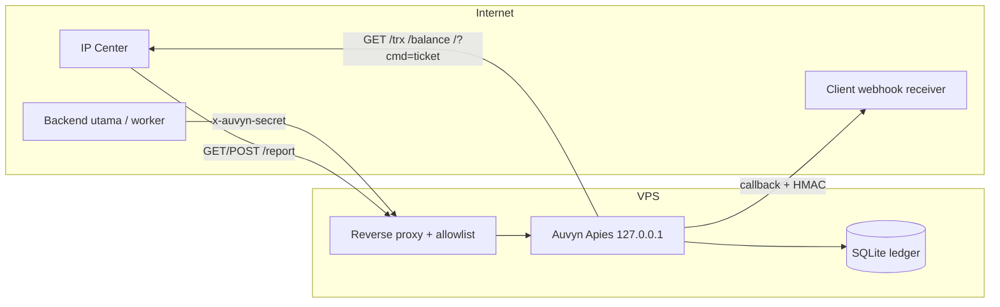

# SECURITY — Auvyn Apies

Dokumentasi lengkap: [`docs/`](docs/README.md).

Model keamanan ini disusun dengan satu batasan nyata: **IP Center tidak mau menyesuaikan diri dengan kita.** Prefix, format Otomax, dan URL report sudah ditentukan provider. Karena itu kita tidak boleh menambah syarat yang membuat report sah gagal masuk (misalnya mewajibkan header signature yang tidak pernah mereka kirim).

Pendekatan: pertahanan berlapis yang seluruhnya transparan bagi provider.

---

## 1. Trust Boundary



Aturan:

- App **hanya listen di `127.0.0.1`**; port publik ditutup firewall. Tanpa ini, allowlist di proxy bisa di-bypass dengan menembak port app langsung.
- Reverse proxy yang menegakkan allowlist `/report` dan mencatat IP asli.
- Jangan menaruh jalur report di belakang CDN. Kalau terpaksa, kunci origin ke range CDN dan gunakan header IP dari CDN dengan benar — jangan percaya `X-Forwarded-For` mentah.

---

## 2. Autentikasi `/report` Tanpa Kooperasi Provider

**v2 menolak start** bila `REPORT_ALLOW_IPS` dan `REPORT_TOKEN` sama-sama kosong (kecuali `ALLOW_INSECURE_REPORT=true` untuk development). Ini disengaja: allowlist UFW pada port service saja tidak cukup kalau reverse proxy mem-proxy seluruh path dari domain publik. Kasus itu benar-benar terjadi di lapangan dan sudah diverifikasi (GET `/report` via domain mengembalikan `200 OK`).

Karena provider tidak bisa diminta mengirim token, identitas report dibangun dari tiga hal yang **sudah otomatis dibawa provider**:

1. **IP sumber** — allowlist di reverse proxy.
2. **`refID` yang kita terbitkan** — dibuat acak kriptografis, sehingga berfungsi sebagai bearer token yang tidak bisa ditebak.
3. **Isi transaksi** — `dest` (dan `product` bila tersedia) harus cocok dengan record.

### 2.1 `refID` sebagai token implisit

- Gunakan 64-bit acak dari `crypto/rand`, dikodekan base32 tanpa padding (13 karakter), dengan prefix `AVN` → total 16 karakter, **sama panjang dengan format sekarang**.
- Jangan memperpanjang tanpa bukti bahwa provider menerima `refID` lebih panjang.
- Jangan memakai timestamp, counter, atau UUID yang bisa dikorelasikan.
- `refID` tidak boleh dikirim ke frontend publik; cukup di backend dan log teredaksi.

Konsekuensi: penyerang harus menebak 64 bit **dan** tahu IP allowlist **dan** tahu nomor tujuan. Tanpa insider, ini tidak layak secara ekonomi.

### 2.2 Validasi report

Terima report hanya jika:

1. Sumber ada di allowlist.
2. `refID` ada di ledger.
3. `dest` pada pesan cocok dengan `dest` transaksi (jika pesan memuat tujuan).
4. Format pesan cocok dengan salah satu pola provider (atau status valid yang dikenal).
5. Rate limit per IP tidak terlampaui.

Jika gagal: catat di `provider_reports` dengan alasan, kirim alert, balas `200 OK` **tanpa** memproses (provider tidak perlu tahu; menghindari retry storm). Kecuali `refID` asing — itu sinyal serangan, alert harus eksplisit.

### 2.3 Learning mode untuk IP

Tanpa daftar IP resmi dari provider:

1. **Mode observasi**: jalankan hanya di staging dengan `ALLOW_INSECURE_REPORT=true` dan proxy di belakang firewall; `remote_addr` dicatat.
2. Kumpulkan minimal 7 hari / 50 report.
3. Verifikasi ke provider lewat tiket support: "kami menerima report dari IP X, benar egress Anda?"
4. Pin IP individual. Jika berasal dari pool, pin /24 dan dokumentasikan risikonya.
5. Aktifkan `deny all` untuk sisanya; monitor penolakan.

Selama mode observasi, lapis 2 dan 3 tetap aktif sehingga report palsu tanpa `refID` valid sudah gagal.

### 2.4 Konfigurasi proxy

```nginx
# app hanya di loopback
upstream auvyn { server 127.0.0.1:5882; }

location = /report {
    allow 203.0.113.10;   # contoh IP provider
    deny all;
    proxy_pass http://auvyn;
    proxy_set_header X-Real-IP $remote_addr;
}

location / {
    proxy_pass http://auvyn;
}
```

`location = /report` cocok dengan path apa pun query-nya, jadi URL provider yang sudah terpasang tidak perlu diubah.

**Wajib**: pasang location guard ini di **setiap** vhost yang mem-proxy ke service. Tanpa itu, `location /` tetap meneruskan `/report` dari internet meskipun UFW hanya mengizinkan IP provider ke port aslinya. Contoh siap pakai: `deploy/nginx-report-example.conf`.

---

## 3. Integritas Report & State Machine

Report provider adalah satu-satunya sumber status final. Karena tidak ada signature, integritas dijaga oleh ledger dan aturan transisi:

```
pending ──> success
    └─────> failed
```

- Status final pertama menang.
- Report final berikutnya yang **berbeda** tidak menimpa; simpan di `provider_reports`, tandai `conflict`, kirim alert. Transisi `success → failed` berarti potensi refund dan wajib ditangani manusia.
- Report duplikat dengan status sama diabaikan (idempotent).
- Record transaksi **tidak dihapus** setelah final; report retry harus tetap valid. Ini memperbaiki `deletePending` yang sekarang menghapus konteks.
- Simpan raw report + IP + waktu untuk audit.

---

## 4. Rahasia

| Item | Aturan |
|---|---|
| Permission file | `.env` dan `data/auvyn.db` mode `600`, owner service. DB audit menyimpan raw report (termasuk SN) untuk sengketa. |
| `AUVYN_SECRET`, `ADMIN_*`, kredensial provider | Hanya dari environment; fail-fast saat start bila kosong |
| `data/db.json` | **Tidak boleh di-track git**; tambahkan `data/` ke `.gitignore` |
| `secret_callback` client | Boleh plaintext di DB karena dipakai untuk mengirim; tidak pernah ditampilkan di list |
| Kredensial client (`secret`, `pin`, `keys`) | Disimpan sebagai hash; verifikasi timing-safe |
| Log | Dilarang memuat query URL center, `pin`, `password`, `sign`, atau token report |
| Query auth | Dilarang (`?secret=`); hanya header |
| Rotasi | Endpoint client rotate dipertahankan; rotasi client "test" yang sudah terlanjur commit |

Redaksi wajib sebelum log/Telegram/callback:

- `HRG:…@`, `M-Bal:…`, `#Inject…`, `memberID=…`, `sign=…`, URL `/trx?…`
- **`SN/Ref: …` dan `SN: …`** — tersedia untuk client pemilik di `providerResult.sn`/`raw`; log dan notifikasi Telegram tetap meredaksinya.

---

## 5. Callback Keluar

Sekarang: secret plaintext di header, tanpa tanda tangan body, tanpa retry.

v2:

- `X-Auvyn-Signature: HMAC-SHA256(secret_callback, timestamp + "." + body)`
- `X-Auvyn-Timestamp` dan `event_id` untuk anti-replay/idempotensi.
- Header secret lama tetap dikirim selama masa transisi.
- Retry backoff + dead-letter; kegagalan memicu alert, bukan hanya `logger.warn`.
- URL webhook divalidasi: tolak skema selain `https` (kecuali development), tolak loopback/link-local/private range, resolusi DNS dicek ulang sebelum koneksi untuk mencegah SSRF. Admin tetap bisa override lewat env eksplisit.

---

## 6. Ancaman & Mitigasi

| Ancaman | Dampak | Mitigasi |
|---|---|---|
| Report palsu tanpa insider | Status/uang salah | Allowlist IP + `refID` acak + `dest` cocok + tolak `refID` asing |
| Replay report | Event ganda | `UNIQUE(ref_id, status_final)` + `event_id` |
| `refID` ditebak | Forgery | 64-bit acak, panjang sama dengan format lama |
| Kebocoran secret di repo | Takeover | Untrack `data/`, `.gitignore`, rotasi, scan CI |
| Kebocoran kredensial di log | Akses center | Redaksi by construction; log hanya `ref_id`, host, status |
| SSRF via URL webhook | Akses jaringan internal | Validasi skema + blokir IP privat + re-resolve DNS |
| Flood `/report` | CPU/DB | Rate limit per IP + body limit + hanya simpan ringkas |
| Reverse proxy membuka `/report` | Forgery status | `location = /report` allowlist di semua vhost + app guard wajib |
| Log/journal membengkak | Disk penuh | Log ke stdout, journald `SystemMaxUse`, prune harian + WAL checkpoint |
| Chat Telegram salah | Alert hilang | Self-check saat start + log description (rate-limited) |
| Token/chat ID bot admin bocor | Manipulasi client/webhook | Allowlist private chat, token bot terpisah, rotasi token, audit log perintah tanpa argumen sensitif |
| Restart saat transaksi | Konteks hilang | Ledger SQLite, bukan Map memori |
| Konflik status | Refund tak tercatat | Simpan konflik, alert, jangan menimpa |
| Admin creds bocor | Manipulasi client | Rotasi, timing-safe compare, audit log aksi admin |

---

## 7. Residual Risk (Didokumentasikan, Bukan Disembunyikan)

1. Selama provider tidak memberi IP statis, allowlist tidak bisa ditegakkan penuh; keamanan bergantung pada `refID` acak + pencocokan tujuan + monitoring.
2. Tanpa signature provider, kita tidak bisa membuktikan integritas isi pesan selain melalui korelasi ledger.
3. `secret_callback` tersimpan plaintext karena harus dikirim; kompromi DB berarti kompromi callback. Mitigasi: enkripsi at-rest atau KMS bila diperlukan.
4. SQLite adalah single-node; bukan masalah untuk satu VPS, tapi bukan solusi multi-region.
5. Provider bisa mengubah format Otomax tanpa pemberitahuan; parser harus punya alert "pesan tidak dikenal" yang tinggi prioritasnya. Pengalaman lapangan menunjukkan seluruh respons dapat tercatat `UNKNOWN`; pola live sudah ditambahkan ke v2.
6. Jika `ALLOW_INSECURE_REPORT=true` dipakai di lapangan, `/report` kembali tidak terautentikasi. Jangan lakukan.

---

## 8. Operasional

- Backup: `sqlite3 auvyn.db "VACUUM INTO '/backup/auvyn-$(date +%F).db'"` harian + retensi.
- Log: stdout/journald, JSON, tanpa kredensial.
- Health: `/healthz` (proses hidup), `/readyz` (DB ping + koneksi center opsional).
- Alert wajib: report dari IP asing, `refID` asing, konflik status, delivery dead-letter, saldo rendah, parser unknown.
- Log: stdout/journald (bukan file aplikasi). Pasang `SystemMaxUse` dan jalankan `journalctl --vacuum-size` bila perlu.
- Retensi: `RETENTION_DAYS` (default 365) memprune delivery `delivered`/`dead`, event tanpa delivery, dan `provider_reports`. Tabel `transactions` tidak pernah dipangkas.
- Jalankan `deploy/backup.sh` harian (`VACUUM INTO`, retensi 14 hari).
- `TELEGRAM_SELFCHECK=true` memverifikasi token/chat saat start; cek log `telegram chat ok` untuk keempat kategori.
- Rotasi kredensial client & secret callback lewat endpoint yang ada; catat waktu rotasi.
- Runbook insiden: blokir IP di proxy → cek `provider_reports` → rekonsiliasi manual dengan provider → putuskan status.
