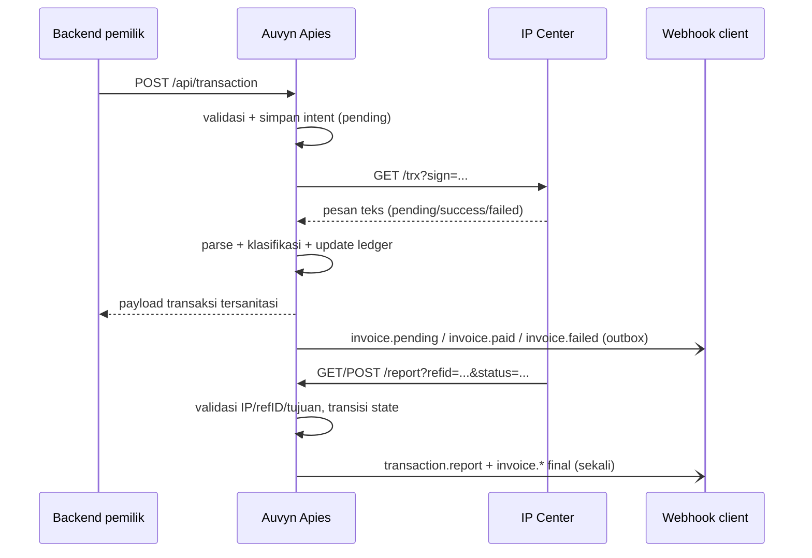

# 01 — Ikhtisar

Auvyn Apies adalah service bridge yang menghubungkan backend pemilik produk dengan IP Center (engine penyedia produk digital bergaya Otomax). Backend tidak perlu mengetahui detail signature, format query, atau format pesan provider.

## Masalah yang diselesaikan

Tanpa bridge, setiap backend harus:

- menghitung signature SHA1/base64url dengan template provider;
- menangani perbedaan parameter transaksi biasa dan produk nominal-bebas;
- mem-parsing pesan teks provider yang tidak terstruktur;
- menyimpan korelasi `refID` agar laporan akhir bisa dicocokkan;
- mengirim callback ke satu atau banyak konsumen;
- menangani retry, duplikasi, dan konflik status.

Service ini memusatkan semua itu dalam satu proses dengan ledger SQLite.

## Fitur

- Transaksi pulsa/data/voucher/game ke provider.
- Cek saldo dan pembuatan tiket M-Bal.
- Mode produk nominal-bebas (nominal tidak dikirim, `qty` mewakili nominal).
- Parsing pola Otomax, termasuk format lapangan dan `Inject`.
- Ledger transaksi durable (SQLite) dengan status final yang tidak bisa ditimpa diam-diam.
- Callback legacy (satu/beberapa URL dari environment) dan managed webhook per client.
- Outbox delivery dengan retry, backoff, dead-letter, dan HMAC-SHA256.
- `/report` inbound yang diproteksi allowlist IP, token opsional, `refID`, dan pencocokan tujuan.
- Notifikasi Telegram per kategori dengan redaksi dan rate-limited error logging.
- Telegram admin bot opsional untuk kelola client/webhook dari private chat.
- Statistik operasional dan retensi otomatis.
- API admin/client v1 yang resource-oriented; path lama tetap tersedia sebagai alias deprecated.

## Alur utama

## Status dan kategori

Kategori transaksi:

| Kategori | Arti |
|---|---|
| `pending` | provider belum memberi hasil final |
| `success` | transaksi berhasil |
| `failed` | transaksi gagal atau dibatalkan |

Status final pertama menang. Report final yang berbeda dicatat sebagai konflik dan tidak menimpa status final sebelumnya.

## Batasan yang disengaja

- Satu instance per database. SQLite dan dispatcher outbox dirancang untuk satu proses.
- Protokol keluar ke provider bersifat beku; lihat [09 — Protokol provider](09-provider-protocol.md).
- Provider tidak dapat diminta menambah header signature pada report; kontrol inbound mengandalkan IP, `refID`, dan pencocokan tujuan.
- Service tidak melakukan rekonsiliasi otomatis ke provider bila provider tidak menyediakan endpoint status.
- Semua transaksi disimpan permanen; hanya outbox dan audit report yang dipangkas.

## Kompatibilitas

- Go 1.22+
- SQLite via `modernc.org/sqlite` (pure Go, tanpa cgo)
- Satu binary, tanpa runtime eksternal
- Linux/systemd direkomendasikan; binary juga dapat dijalankan manual

## Dokumen terkait

- Arsitektur: [02 — Arsitektur](02-architecture.md)
- Kontrak protokol: [09 — Protokol provider](09-provider-protocol.md)
- Keamanan: [12 — Keamanan](12-security.md)
