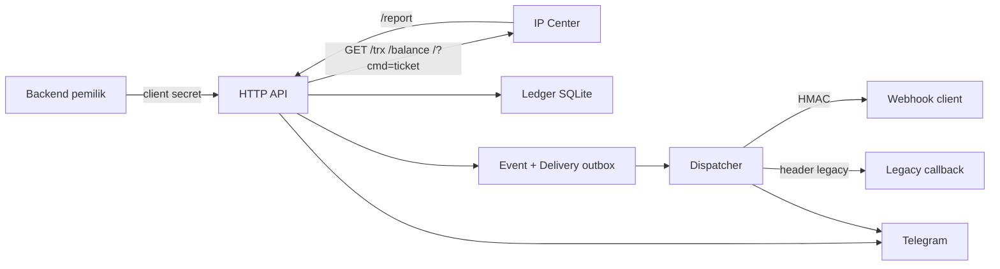
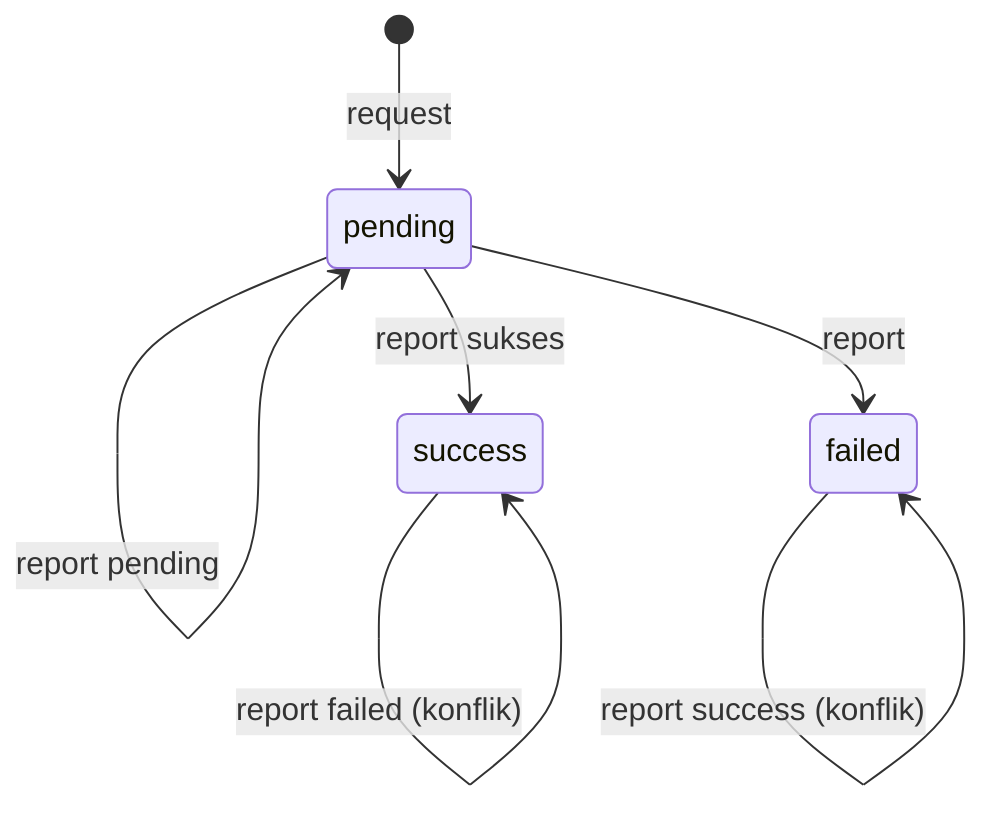
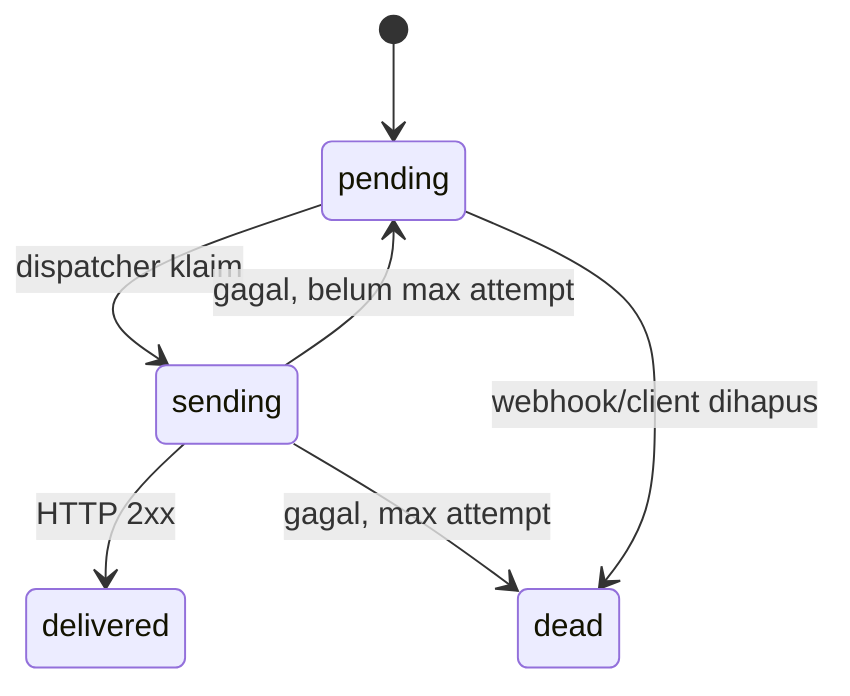

# 02 — Arsitektur

## Prinsip

1. **Provider protocol adalah batas beku.** Semua yang keluar ke provider diisolasi di `internal/ipcenter`.
2. **Uang tidak boleh hilang karena restart.** State bisnis disimpan di SQLite, bukan memori.
3. **Event keluar tidak dikirim langsung dari handler.** Handler menulis event + delivery ke outbox dalam satu transaksi database; dispatcher mengirimkannya.
4. **Idempotensi eksplisit.** `refID` unik untuk transaksi, `dedupe_key` unik untuk event.
5. **Kegagalan provider bersifat ambigu.** Timeout tidak menghapus intent; retry tidak boleh menagih dua kali.

## Komponen

| Paket | Tanggung jawab |
|---|---|
| `cmd/auvyn` | Entry point, flag/subcommand, wiring, graceful shutdown, maintenance |
| `internal/config` | Membaca environment, parsing, validasi fail-fast |
| `internal/logging` | slog JSON ke stdout, helper URL aman |
| `internal/security` | ID/token acak, SHA-256 hash, constant-time compare |
| `internal/ipcenter` | Signature, URL builder, parser Otomax, klasifikasi, sanitasi, HTTP client provider |
| `internal/store` | Skema SQLite, transaksi, client/webhook, outbox, stats, prune, importer |
| `internal/httpapi` | Routing, middleware auth, handler API/report/admin/client, envelope |
| `internal/webhook` | Validasi URL/SSRF, dispatcher, backoff, HMAC |
| `internal/notify` | Telegram async, escaping, truncation, self-check, dedupe log |
| `internal/version` | Versi service |

## Request lifecycle: transaksi

1. `POST /api/transaction` divalidasi (`product`, `dest`, nominal untuk produk bebas).
2. Service mengecek `refID`; jika sudah final, mengembalikan replay tanpa memanggil provider.
3. Service menulis **intent** `pending` ke `transactions` sebelum menghubungi provider.
4. `internal/ipcenter` membangun signature + URL, memanggil provider dengan timeout 20 detik.
5. Hasil diparse, diklasifikasi, dan `UpdateTransactionResult` mengisi kategori/state/SN.
6. Event `transaction.request` + delivery legacy ditulis ke outbox; event `invoice.*` untuk managed webhook ditulis dengan dedupe key sendiri.
7. Respons API mengembalikan payload tersanitasi. Callback dikirim oleh dispatcher, bukan di dalam request handler.

Jika provider timeout, intent tetap ada. Retry dengan `refID` yang sama menghasilkan `409 IN_PROGRESS` sampai direkonsiliasi.

## Request lifecycle: report

1. `/report` memeriksa allowlist IP dan token (jika dikonfigurasi).
2. Field `refid`, `message`, `status` dibaca dari query, body JSON, form, atau teks.
3. `refID` harus ada di ledger; yang tidak dikenal dicatat sebagai rejected dan dibalas `200 OK`.
4. Destination pada pesan provider dibandingkan dengan `transactions.dest`.
5. Kategori dihitung dengan presedensi: teks gagal eksplisit menang atas status numerik.
6. `ApplyReport` melakukan transisi atomik `pending -> success|failed`; duplikat dan konflik dicatat.
7. Event legacy `transaction.report` dan event managed `invoice.*` ditulis sekali per kategori.
8. Raw report + IP + alasan diterima/ditolak disimpan di `provider_reports`.

## Outbox dan dispatcher

- Handler menulis `events` dan `deliveries` dalam satu transaksi.
- `dedupe_key` unik mencegah event ganda.
- Dispatcher berjalan setiap detik, mengambil delivery `pending` yang jatuh tempo, mengirim POST, lalu menandai `delivered` atau menjadwalkan retry.
- Backoff default: `1m,5m,30m,2h,6h,24h`; setelah `DELIVERY_MAX_ATTEMPTS` menjadi `dead` dan memicu alert.
- Delivery yang masih `sending` saat proses berhenti diklaim ulang saat start.

## Konkurensi dan konsistensi

| Area | Model |
|---|---|
| HTTP | `net/http` dengan timeout read/write/idle |
| SQLite | WAL, `busy_timeout=5000`, foreign keys aktif, pool koneksi kecil |
| Transaksi bisnis | `UPDATE ... WHERE category='pending'` agar transisi final hanya sekali |
| Outbox | Satu dispatcher, klaim per delivery, urutan berdasarkan ID |
| Report | Update atomik + `UNIQUE` dedupe key |
| Shutdown | Server berhenti, context dispatcher dibatalkan, worker ditunggu, DB ditutup |

Tidak ada dukungan multi-instance. Menjalankan dua proses pada database yang sama dapat menyebabkan pengiriman ganda.

## Batas kegagalan

| Kegagalan | Perilaku |
|---|---|
| Provider lambat/timeout | API 502, intent disimpan, retry tidak memanggil provider |
| Provider mengembalikan teks tak dikenal | Fallback klasifikasi teks; detail provider mungkin kosong |
| Callback client gagal | Retry; setelah habis menjadi dead + alert |
| Proses restart | Ledger dan outbox tetap; delivery `sending` diklaim ulang |
| SQLite terkunci sementara | `busy_timeout`; request gagal 500 jika tetap terkunci |
| Report duplikat | Diabaikan, tidak ada event baru |
| Report final berbeda | Konflik dicatat dan di-alert; status lama dipertahankan |

## Keputusan desain penting

- **Signature SHA1 bukan pilihan kita.** Algoritma mengikuti provider; lihat [09](09-provider-protocol.md).
- **RefID acak 64-bit untuk transaksi tanpa `refID`.** Panjang tetap 16 karakter agar aman terhadap batas kolom provider.
- **Tidak ada broadcast webhook tanpa `client_id`.** Mencegah kebocoran data antar-client.
- **Raw report disimpan untuk audit**, tetapi tidak pernah dikirim ke callback tanpa redaksi.
- **Log ke stdout**, bukan file aplikasi; journald yang mengatur retensi.

## Diagram state

Transaksi:

`conflict` bukan state database; konflik dicatat di `provider_reports` dan status final dipertahankan.

Delivery:

## Dokumen terkait

- Database: [11 — Database](11-database.md)
- Report: [08 — Report provider](08-report-ingestion.md)
- Webhook: [10 — Webhook](10-webhooks.md)
- Deployment: [14 — Deployment](14-deployment.md)
