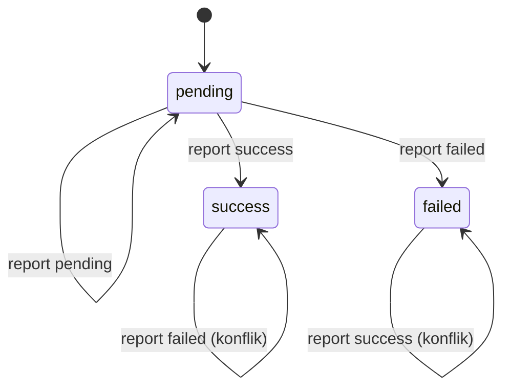

# 08 — Report provider

`/report` adalah endpoint **masuk** yang dipanggil IP Center untuk mengirim status akhir transaksi. Service tidak memanggil endpoint ini.

## Batasan penting

Provider tidak mau menyesuaikan format, prefix, atau URL. Karena itu:

- jangan mewajibkan header signature yang tidak dikirim provider;
- jangan mengubah URL report yang sudah terpasang di sisi provider;
- kontrol keamanan harus transparan bagi provider.

## Endpoint

```http
GET  /report?refid=<id>&status=<kode>&message=<pesan>
POST /report
PUT  /report
...
```

Semua method HTTP diterima. Field dibaca dari query dan body:

| Field | Query | Body | Wajib |
|---|---|---|---|
| `refid` / `refID` | ya | ya | ya |
| `status` | ya | ya | tidak |
| `message` | ya | ya | tidak |

Query diprioritaskan di atas body. Body didukung dalam bentuk:

- JSON object;
- `application/x-www-form-urlencoded`;
- `text/plain` berisi query string;
- teks bebas tanpa `=` (dianggap `message`).

Body maksimum 64 KB.

## Respons

| Kondisi | Status | Body |
|---|---|---|
| Diproses/diabaikan dengan aman | 200 | `OK` |
| IP tidak diizinkan | 403 | JSON error |
| Token salah | 403 | JSON error |
| `refID` tidak dikenal | 200 | `OK` (dicatat + alert) |
| Destination tidak cocok | 200 | `OK` (dicatat + alert) |
| Konflik status final | 200 | `OK` (dicatat + alert) |

Provider tidak perlu retry untuk kasus yang sudah dicatat. Status 403 hanya untuk pelanggaran guard.

## Urutan validasi

1. **IP allowlist** (`REPORT_ALLOW_IPS`) bila diisi.
2. **Token** (`REPORT_TOKEN`) bila diisi; lokasi: `?key=`, `?token=`, atau header `X-Report-Token`.
3. Baca body.
4. `refID` wajib ada.
5. `refID` harus ada di tabel `transactions`.
6. Jika pesan memuat tujuan, digit tujuan harus sama dengan `dest` transaksi.
7. Klasifikasi kategori.
8. Transisi state atomik.
9. Catat audit di `provider_reports`.
10. Enqueue event callback.

### IP asli di belakang proxy

Jika peer langsung adalah `TRUSTED_PROXY_CIDRS`, service memakai `X-Real-IP`; jika tidak ada, hop pertama `X-Forwarded-For`. Jika peer bukan trusted proxy, header tersebut diabaikan dan IP peer dipakai.

Contoh nginx:

```nginx
location = /report {
    allow 203.0.113.10;
    deny all;
    proxy_pass http://127.0.0.1:5882;
    proxy_set_header Host $host;
    proxy_set_header X-Real-IP $remote_addr;
    proxy_set_header X-Forwarded-For $proxy_add_x_forwarded_for;
}
```

**Wajib dipasang di setiap vhost yang mem-proxy service.** Tanpa itu, `location /` tetap membuka `/report` dari internet meskipun firewall membatasi port asli.

## Klasifikasi report

Presedensi di `ClassifyReport`:

1. Pesan mengandung `gagal`, `failed`, `error`, atau `reject` → `failed`.
2. `status == "20"` atau pesan mengandung `sukses`/`success` → `success`.
3. Parser Otomax: state `SUCCESS` → `success`; `FAILED`/`NOT_FOUND` → `failed`.
4. Selain itu → `pending`.

Perbedaan penting dari implementasi lama: teks gagal eksplisit **menang** atas `status=20`. Contoh:

```text
status=20, message="R1.081234 GAGAL. Nomor tujuan salah."
→ failed
```

## State machine



Aturan:

- Transisi hanya terjadi dari `pending`.
- Kategori final pertama menang.
- Report dengan kategori sama → `duplicate`, tidak ada event baru.
- Report final berbeda → `conflict`, status tidak berubah, dicatat dan di-alert.
- Transaksi tidak pernah dihapus setelah final; report retry tetap valid.
- Transaksi `pending` tanpa hasil provider > 15 menit muncul sebagai `staleIntents` di stats.

## Audit

Setiap report — diterima maupun ditolak — dicatat di `provider_reports`:

| Kolom | Isi |
|---|---|
| `ref_id` | refID dari report |
| `accepted` | 1/0 |
| `reason` | `applied`, `duplicate`, `conflict`, `unknown_ref`, `missing_ref`, `dest_mismatch` |
| `category` | kategori hasil klasifikasi |
| `remote_ip` | IP yang terlihat service |
| `method` | method HTTP |
| `query` | query tanpa `key`/`token` |
| `body` | body mentah (maks 64 KB) |
| `raw_message` | pesan provider mentah (audit SN) |
| `received_at` | waktu UTC |

File database harus dilindungi karena raw report dapat memuat SN dan nomor tujuan.

## Event yang dihasilkan

Saat report diterapkan:

- legacy: `transaction.report`;
- managed webhook: `invoice.paid` / `invoice.failed` / `invoice.pending`, di-dedupe per `refID` dan kategori.

Report duplikat/konflik tidak menghasilkan event baru.

## Notifikasi

Setiap report yang diterima/ditolak memicu notifikasi sistem (jika bot sistem dikonfigurasi). Isi pesan diredaksi sebelum dikirim.

## Rate limit

Service tidak memiliki rate limiter internal untuk `/report`; gunakan `limit_req` di reverse proxy dan body limit. Dengan allowlist IP yang benar, permukaan serangan jauh lebih kecil.

## Contoh

```bash
curl -sS "http://127.0.0.1:5882/report?refid=AVN-DEMO-1&status=20&message=$(python3 -c 'import urllib.parse;print(urllib.parse.quote("R12345.081234567890 SUKSES. SN/Ref: SN-ABC. Saldo 100.000 - 10.000 = 90.000"))')"
# OK
```

## Troubleshooting singkat

| Gejala | Arti |
|---|---|
| `403 FORBIDDEN source IP not allowed` | IP report tidak ada di `REPORT_ALLOW_IPS` |
| `403 FORBIDDEN invalid report token` | token tidak cocok |
| `200 OK` tetapi transaksi tidak berubah | refID asing, destination mismatch, duplikat, atau konflik |
| Transaksi tetap pending | report belum diterima atau kategori pending |
| Konflik berulang | provider mengirim status final yang berbeda; rekonsiliasi manual |

Detail diagnosis: [17 — Troubleshooting](17-troubleshooting.md).

## Dokumen terkait

- Protokol provider: [09 — Protokol provider](09-provider-protocol.md)
- State/database: [11 — Database](11-database.md)
- Webhook: [10 — Webhook](10-webhooks.md)
