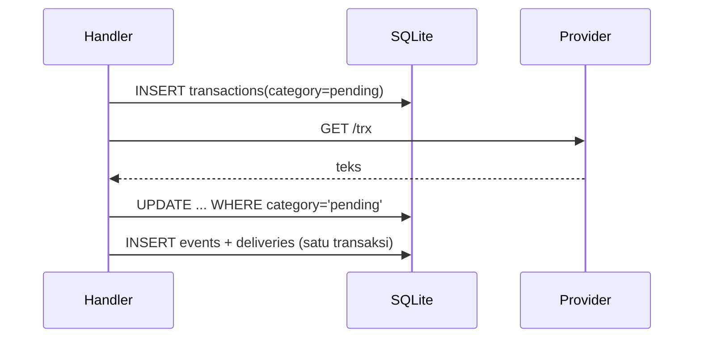

# 11 — Database

Service memakai SQLite melalui `modernc.org/sqlite` (pure Go). Satu file database berisi client, webhook, transaksi, outbox, dan audit report.

## Lokasi dan mode

| Item | Nilai |
|---|---|
| Default path | `$DATA_DIR/auvyn.db` |
| Override | `DB_PATH` |
| Mode jurnal | WAL |
| `busy_timeout` | 5000 ms |
| `synchronous` | NORMAL |
| Foreign keys | ON |
| Pool | maksimum 4 koneksi |

WAL menghasilkan file `auvyn.db-wal` dan `auvyn.db-shm`. Backup online harus memakai `VACUUM INTO` atau `.backup`, bukan copy file utama saat service berjalan.

## Skema

### `clients`

| Kolom | Tipe | Keterangan |
|---|---|---|
| `client_id` | TEXT PK | `avn_cl_...` |
| `client_name` | TEXT | nama client |
| `status` | TEXT | `ACTIVE`/`DELETED` |
| `registered_at` | TEXT | waktu dibuat |
| `secret_hash` | TEXT | SHA-256 base64 dari client secret |
| `pin_hash` | TEXT | SHA-256 base64 dari PIN |
| `keys_hash` | TEXT | SHA-256 base64 dari keys |
| `secret_callback` | TEXT | secret callback plaintext untuk HMAC |
| `secret_callback_rotated_at` | TEXT | waktu rotasi |
| `deleted_at` | TEXT | soft delete |

`secret_callback` plaintext diperlukan karena service harus menghitung HMAC. Hash kredensial client tidak dapat dikembalikan.

### `webhooks`

| Kolom | Keterangan |
|---|---|
| `webhook_id` | `avn_wh_...` |
| `client_id` | pemilik |
| `url` | target |
| `status` | `ACTIVE`/`DELETED` |
| `created_at`, `updated_at`, `deleted_at` | waktu |

Event subscription ada di `webhook_events(webhook_id, event)`, primary key gabungan.

### `transactions`

| Kolom | Keterangan |
|---|---|
| `ref_id` | PK, idempotensi |
| `client_id` | dari `meta.client_id` |
| `product`, `dest` | permintaan |
| `qty`, `nominal` | integer nullable |
| `category` | `pending`/`success`/`failed` |
| `provider_state`, `provider_code` | hasil parser |
| `provider_trxid`, `sn` | detail provider |
| `request_raw` | respons awal provider |
| `report_raw` | pesan report terakhir |
| `meta` | JSON |
| `created_at`, `updated_at` | waktu |
| `final_at` | waktu final |

Tabel ini adalah ledger keuangan dan **tidak pernah dipangkas otomatis**.

### `events`

| Kolom | Keterangan |
|---|---|
| `id` | autoincrement |
| `ref_id` | referensi transaksi (boleh kosong) |
| `kind` | `transaction.request`, `transaction.report`, `balance.check`, `balance.ticket`, atau `invoice.*` |
| `dedupe_key` | **UNIQUE**, mencegah event ganda |
| `payload` | JSON tersanitasi |
| `created_at` | waktu |

### `deliveries`

| Kolom | Keterangan |
|---|---|
| `id` | autoincrement |
| `event_id` | FK ke events |
| `target_kind` | `legacy`/`managed` |
| `target_name` | nama target |
| `client_id`, `webhook_id` | nullable |
| `url` | snapshot URL |
| `event_name` | nama event yang dikirim |
| `status` | `pending`/`sending`/`delivered`/`dead` |
| `attempts` | jumlah percobaan |
| `next_attempt_at` | jadwal retry |
| `last_error` | error terakhir |
| `response_status` | status HTTP terakhir |
| `created_at`, `delivered_at` | waktu |

### `provider_reports`

Audit setiap report provider:

| Kolom | Keterangan |
|---|---|
| `id` | autoincrement |
| `ref_id` | nullable |
| `accepted` | 1/0 |
| `reason` | `applied`, `duplicate`, `conflict`, `unknown_ref`, `missing_ref`, `dest_mismatch` |
| `category` | hasil klasifikasi |
| `remote_ip`, `method` | metadata request |
| `query` | query tanpa token |
| `body` | body mentah |
| `raw_message` | pesan mentah (dapat memuat SN) |
| `received_at` | waktu |

## Alur penulisan transaksi



- `refID` duplikat saat insert → `DUPLICATE_REF`.
- Timeout provider → intent tetap `pending`.
- Transisi final memakai `UPDATE ... WHERE category='pending'` agar hanya satu yang menang.
- Event ditulis setelah hasil provider diketahui.

## Alur report

`ApplyReport`:

1. `UPDATE transactions SET ... WHERE ref_id=? AND category='pending'`.
2. Jika 1 baris berubah → `applied`.
3. Jika tidak ada baris:
   - tidak ditemukan → `not_found`;
   - kategori sama → `duplicate`;
   - kategori final berbeda → `conflict`.
4. Konflik tidak mengubah status.

## Dedupe key

| Event | Contoh key |
|---|---|
| Legacy request | `transaction.request:<refID>` |
| Legacy report | `transaction.report:<refID>:<category>` |
| Managed final | `invoice:<category>:<refID>` |
| Balance/tiket | prefix + token acak |

`dedupe_key` unik di tabel `events`. Insert event yang sudah ada tidak menambah delivery.

## Retensi dan pemeliharaan

`RETENTION_DAYS` (default 365, `0` = nonaktif) menjalankan prune harian:

1. hapus delivery `delivered`/`dead` lebih tua dari cutoff;
2. hapus event lebih tua yang tidak punya delivery;
3. hapus `provider_reports` lebih tua dari cutoff;
4. `PRAGMA wal_checkpoint(TRUNCATE)`.

Yang **tidak** dihapus:

- `transactions`;
- client/webhook (hanya soft delete);
- delivery `pending`/`sending`.

Prune berjalan saat startup dan setiap 24 jam. Hasilnya dilog: jumlah delivery/event/report yang dihapus.

## Statistik

`GET /admin/v1/stats` membaca:

- jumlah transaksi per kategori;
- stale intent (`pending` tanpa state provider > 15 menit);
- jumlah event;
- delivery per status;
- report 24 jam dan rejected 24 jam;
- client/webhook aktif;
- ukuran file database utama.

## Inspeksi

```bash
sqlite3 data/auvyn.db ".tables"
sqlite3 data/auvyn.db "SELECT category, COUNT(*) FROM transactions GROUP BY 1;"
sqlite3 data/auvyn.db "SELECT status, COUNT(*) FROM deliveries GROUP BY 1;"
sqlite3 data/auvyn.db "SELECT ref_id, category, provider_code, final_at FROM transactions ORDER BY created_at DESC LIMIT 5;"
sqlite3 data/auvyn.db "SELECT ref_id, accepted, reason, received_at FROM provider_reports ORDER BY id DESC LIMIT 10;"
```

## Backup

```bash
sqlite3 /opt/auvyn-apies/data/auvyn.db \
  "VACUUM INTO '/backup/auvyn-$(date +%F-%H%M).db'"
```

Atau:

```bash
DB_PATH=/opt/auvyn-apies/data/auvyn.db \
BACKUP_DIR=/opt/auvyn-apies/backup \
KEEP_DAYS=14 \
./deploy/backup.sh
```

Restore:

1. hentikan service;
2. simpan file lama;
3. salin backup ke `DB_PATH`;
4. hapus `-wal`/`-shm` lama;
5. start service dan cek `/readyz`.

## Batasan

- Satu penulis; jangan menjalankan lebih dari satu instance pada DB yang sama.
- Tidak ada migrasi versi otomatis untuk perubahan kolom. Skema saat ini memakai `CREATE TABLE IF NOT EXISTS`; perubahan struktur harus disertai migrasi eksplisit.
- Ukuran transaksi tumbuh permanen; arsipkan manual bila diperlukan.
- File DB dan `.env` harus mode `0600` karena memuat secret/audit sensitif.

## Dokumen terkait

- Arsitektur: [02 — Arsitektur](02-architecture.md)
- Webhook/outbox: [10 — Webhook](10-webhooks.md)
- Operasional: [13 — Operasional](13-operations.md)
