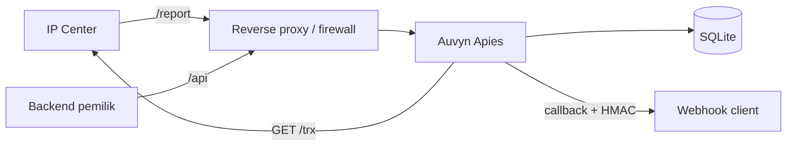

# 12 — Keamanan

Dokumen ini menjelaskan trust boundary, kontrol yang diterapkan, dan risiko residual. Dokumen ringkas juga tersedia di `SECURITY.md`.

## Aset yang dilindungi

- kredensial provider (`PIN`, `PASSWORD`, signature);
- kredensial client (secret, PIN, keys, callback secret);
- secret admin dan API;
- status transaksi dan uang;
- nomor tujuan, SN, saldo, dan metadata order;
- integritas callback ke konsumen.

## Trust boundary



- Internet tidak boleh langsung mencapai app kecuali melalui firewall/proxy.
- App sebaiknya bind loopback; jika provider memanggil port langsung, firewall wajib membatasi per IP.
- Database adalah aset lokal; file permission harus ketat.

## `/report`

Provider tidak dapat diminta menambah token/header. Karena itu kontrolnya:

1. **Allowlist IP** `REPORT_ALLOW_IPS` (app) dan firewall/reverse proxy.
2. **Token opsional** `REPORT_TOKEN` bila provider/URL memungkinkan.
3. **`refID` tidak dapat ditebak**; transaksi tanpa `refID` memakai 64-bit acak, panjang tetap 16 karakter.
4. **Pencocokan destination** antara pesan report dan ledger.
5. **Penolakan refID asing** dan pencatatan audit.
6. **Idempotensi dan state machine** agar report palsu/berulang tidak menggandakan event.
7. **Rate limit** di reverse proxy.

Service **menolak start** bila tidak ada allowlist/token, kecuali `ALLOW_INSECURE_REPORT=true` (development).

### Pelajaran dari deployment lapangan

Allowlist pada port service saja tidak cukup. Reverse proxy yang mem-proxy seluruh `/` juga meneruskan `/report` dari domain publik. Setiap vhost wajib memiliki:

```nginx
location = /report {
    allow 203.0.113.10;
    deny all;
    proxy_pass http://127.0.0.1:5882;
}
```

Tanpa itu, penyerang yang mengetahui `refID` dapat memalsukan status final.

### Trusted proxy

`TRUSTED_PROXY_CIDRS` menentukan kapan `X-Real-IP`/`X-Forwarded-For` dipercaya. Jangan percaya header tersebut dari peer publik. Jika app langsung diakses provider, IP peer dipakai dan header diabaikan.

## Autentikasi

### API publik

`/api/transaction` wajib memakai kredensial client (`client_secret`, PIN, keys), sehingga transaksi terikat ke client dan `meta.client_id` tidak bisa dipalsukan. `/api/ping`, `/api/balance`, dan `/api/ticket-mbal` memakai `x-auvyn-secret` operasional yang dibandingkan constant-time. Secret tidak diterima dari query string.

### Admin

`Authorization: Bearer <ADMIN_SECRET>` atau `x-admin-secret`, ditambah `X-Admin-Pin` dan `X-Admin-Keys`. Ketiganya harus cocok. Endpoint admin mengembalikan 500 bila konfigurasi kosong.

### Client

`Authorization: Bearer <client_secret>` atau `x-client-secret`, ditambah `X-Client-Pin` dan `X-Client-Keys`. Kredensial disimpan sebagai SHA-256 base64; verifikasi constant-time.

### Keterbatasan

- SHA-256 tanpa salt untuk kredensial client dapat di-brute-force jika entropi rendah. Kredensial dibuat acak dengan panjang cukup.
- Rotasi client secret/PIN/keys belum tersedia; hanya callback secret yang dapat dirotasi.
- Tidak ada rate limit internal; gunakan reverse proxy.

## Rahasia

| Item | Penyimpanan | Catatan |
|---|---|---|
| Kredensial provider | environment | jangan commit/log |
| `AUVYN_SECRET`, admin creds | environment | file `.env` mode 0600 |
| Client secret/PIN/keys | hash di SQLite | plaintext hanya sekali saat create |
| `secret_callback` | plaintext di SQLite | diperlukan untuk HMAC |
| Raw report/SN | SQLite | audit; lindungi file DB |

Aturan:

- `.env`, `data/`, `backup/` tidak masuk version control.
- Log tidak boleh memuat query provider, PIN, password, sign, token report, SN, atau saldo.
- Error `*url.Error` di-strip sebelum dilog/dikembalikan.
- Token Telegram tidak boleh muncul di log; error URL di-strip.
- File DB dan `.env` mode `0600`, owner user service.

## Logging

- slog JSON ke stdout.
- Access log hanya method/path/status/duration/IP; query tidak dicatat.
- Raw provider tidak dilog.
- Telegram error yang sama di-log maksimal sekali per 5 menit.
- Redaksi diterapkan sebelum callback dan notifikasi:
  - `SN/Ref`, `SN:` (khusus log/Telegram; client pemilik menerima SN);
  - `Saldo`, `Sal`, `M-Bal`, `HRG`;
  - `sign`, `memberID`;
  - URL `/trx`.

## Webhook keluar

- HMAC-SHA256 atas `timestamp.body`; verifikasi dengan raw body.
- Timestamp Unix untuk anti-replay; konsumen wajib membatasi toleransi.
- Header secret lama tetap dikirim untuk kompatibilitas.
- URL webhook divalidasi:
  - `https` wajib kecuali opt-in;
  - IP privat/loopback/link-local ditolak kecuali opt-in;
  - resolusi DNS diperiksa saat create/update dan saat pengiriman.
- Tidak ada broadcast tanpa `client_id`.
- Menghapus webhook/client membatalkan delivery pending.

## Database

- SQLite lokal, bukan network service.
- WAL + foreign keys.
- Soft delete client/webhook; transaksi permanen.
- Backup memakai `VACUUM INTO`.
- Akses shell ke DB setara akses ke seluruh rahasia callback dan audit.

## Ancaman dan mitigasi

| Ancaman | Dampak | Mitigasi |
|---|---|---|
| Report palsu tanpa insider | status/uang salah | allowlist IP + refID acak + destination + tolak refID asing |
| Replay report | event ganda | dedupe key + state machine |
| Reverse proxy membuka `/report` | forgery | location guard di semua vhost + app fail-fast |
| Secret di repo | takeover | `.gitignore`, rotasi, scan CI |
| Kredensial di log | akses center | redaksi by construction + safe error |
| SSRF via webhook | akses jaringan internal | validasi skema/IP + resolusi DNS |
| Flood `/report` | CPU/DB | rate limit proxy + body limit |
| Log/journal membengkak | disk penuh | stdout + journald cap + prune |
| Chat Telegram salah | alert hilang | self-check + description logging |
| Restart saat transaksi | konteks hilang | ledger SQLite |
| Konflik status | refund tak tercatat | conflict audit + alert |
| Multi-instance | double send | satu proses per DB |

## Residual risk

1. Jika provider memakai IP dinamis, allowlist tidak dapat sepenuhnya ditegakkan; andalkan refID + destination + monitoring.
2. Tanpa signature provider, integritas isi report hanya dapat dikorelasikan lewat ledger.
3. `secret_callback` plaintext: kompromi DB berarti kompromi callback.
4. DNS rebinding tetap mungkin; egress firewall adalah lapisan tambahan.
5. Provider dapat mengubah format Otomax; parser harus diuji ulang dan alert pesan tak dikenal harus dipantau.
6. `ALLOW_INSECURE_REPORT=true` menghapus kontrol report; jangan dipakai di produksi.
7. SQLite bukan solusi multi-node.

## Checklist keamanan deployment

- [ ] `REPORT_ALLOW_IPS` diisi IP provider yang diverifikasi.
- [ ] `location = /report` allowlist di semua vhost nginx.
- [ ] Port app dibatasi firewall.
- [ ] `AUVYN_SECRET` dan admin creds panjang/acak.
- [ ] `.env` dan DB mode 0600.
- [ ] `ALLOW_INSECURE_*` dan `ALLOW_PRIVATE_WEBHOOKS` false di produksi.
- [ ] Backup terenkripsi/terlindungi.
- [ ] Log tidak memuat secret (uji dengan pola).
- [ ] Telegram self-check menunjukkan semua chat valid.
- [ ] Monitoring report asing/konflik/dead-letter aktif.

## Dokumen terkait

- Report: [08 — Report provider](08-report-ingestion.md)
- Webhook: [10 — Webhook](10-webhooks.md)
- Operasional: [13 — Operasional](13-operations.md)
